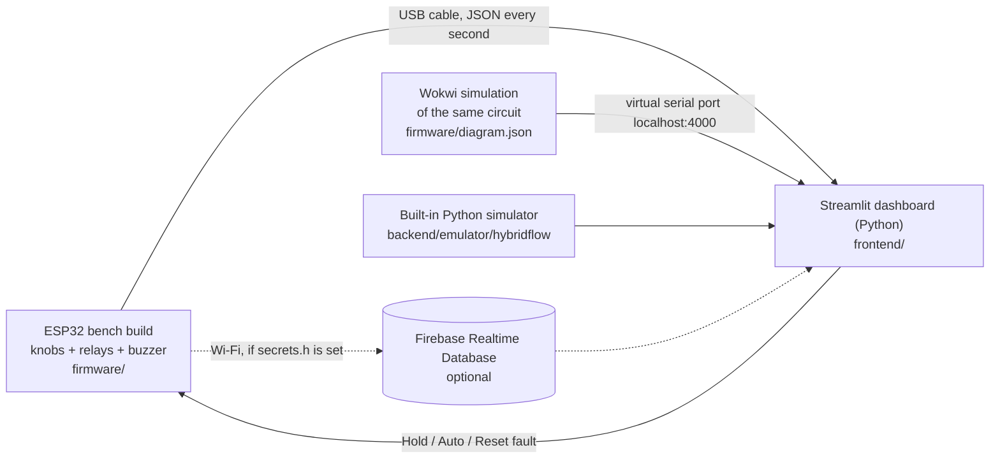
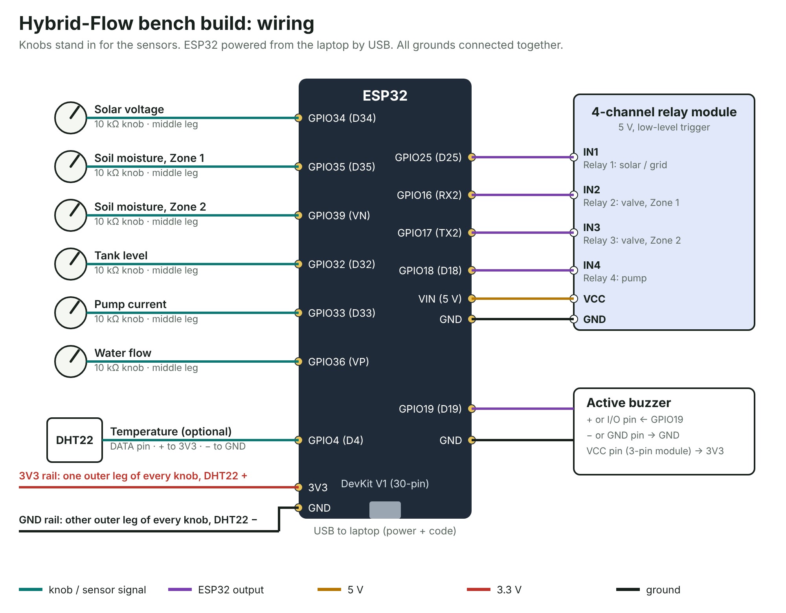

# Hybrid-Flow Smart Irrigation & Energy Manager

ESP32 controller that waters two irrigation zones on solar power first and falls back to the grid only when the soil is critically dry. It protects the pump against dry running, over-current and blocked lines, meters solar versus grid energy, and shows everything live on a Streamlit dashboard written in Python.

BITE401P Embedded Systems and IoT · Project Review 1



## Demo day (the real board)

No Wi-Fi or Firebase needed: the dashboard reads the ESP32 straight over the USB cable.

1. **Upload the firmware** (Arduino IDE): open `firmware/hybrid_flow/hybrid_flow.ino`, board *ESP32 Dev Module*, pick the COM port, Upload. You don't need `secrets.h`; without it the board runs offline.
2. **Watch the boot:** the four relays click once each, in order 1-2-3-4, with a short beep. That's the wiring self-test.
   - All relays on when they should be off? Type `i` in the Serial Monitor (the board remembers it).
   - Buzzer beeping when it should be quiet? Type `b`.
3. **Close the Arduino Serial Monitor** (only one program can use the port), then:
   ```bash
   cd frontend
   pip install -r requirements.txt
   streamlit run app.py
   ```
4. In the sidebar pick **ESP32 over USB**, choose the port, press **Connect**. The sidebar lists what to do with each knob.

Starting knob positions: solar ¾ turn, soil Zone 1 half, soil Zone 2 ¼, tank half, current ⅓, flow half. Zone 2's valve relay clicks, then the pump relay.

If a knob works backwards (turning it up makes the soil *drier*), swap the two outer wires of that trimpot.

## What's in the repo

| Folder | What it is |
|---|---|
| `firmware/hybrid_flow/` | ESP32 Arduino sketch. `control_logic.*` is the switching and protection state machine with no Arduino dependencies; `sensors.*` reads the knobs (bench) or the 7 sensors (field); `cloud.*` handles optional Wi-Fi and Firebase on core 0. |
| `firmware/diagram.json`, `wokwi.toml`, `libraries.txt`, `platformio.ini` | Wokwi simulation of the bench build, and PlatformIO builds for the bench, field and Wokwi profiles. |
| `frontend/` | **Streamlit dashboard** (Python). Reads the ESP32 over USB, the Wokwi simulator, its own built-in simulator, or Firebase. |
| `backend/emulator/` | Python package `hybridflow` (the controller ported to Python, a farm model, a Firebase client) and `device_emulator.py`, which behaves like the ESP32 on the network. |
| `backend/firebase/` | Realtime Database security and validation rules (optional cloud path). |
| `tests/` | `scenarios.json`: 15 behaviour scenarios that the C++ firmware logic and the Python controller both pass. |
| `docs/` | Wiring pictures (`docs/wiring/`) and the Firebase data model. |

## Without hardware: built-in simulator

```bash
cd frontend
pip install -r requirements.txt
streamlit run app.py
```

Pick **Built-in simulator** in the sidebar. It runs the firmware's control logic against a model of the farm. Press **Run guided demo** in the sidebar. Over about six minutes it shows:

1. Cloud cover while Zone 2 is below 30 %: debounced solar loss, break-before-make changeover to grid, and back to solar when the sun returns
2. Tank runs dry: dry-run trip (current under 0.5 A for 3 s)
3. Blocked line: no-flow trip (under 1 L/min for 5 s after start-up)
4. Wi-Fi outage: control continues, data is buffered and uploaded on reconnect
5. Heatwave above 45 °C: irrigation paused with an alarm
6. Tank above 95 %: valves close until it drops below 90 %
7. Jammed impeller: over-current trip after the 1 s inrush window

Each scenario can also be triggered on its own from the sidebar.

## Optional: through Firebase

1. **Create the database.** In the [Firebase console](https://console.firebase.google.com) create a project, then Build → Realtime Database → Create database. Open the Rules tab, paste `backend/firebase/database.rules.json` and publish. Copy the database URL (it ends in `firebaseio.com` or `firebasedatabase.app`).
2. **Start a device**, one of:
   - **Emulator** (fastest): `cd backend/emulator` then `python device_emulator.py --db <URL> --reset`. Standard library only, no install. Add `--tour` to run the guided scenarios from the device side.
   - **Wokwi**: see below.
   - **ESP32 hardware**: see below.
3. **Open the dashboard.** In Streamlit choose *Firebase* in the sidebar, paste the URL and press Connect. Hold, Auto and Reset fault write to `/command`; the device picks them up within 3 s.

## Bench build (about ₹1,000)

The firmware's default profile (`SIM_INPUTS 1` in `config.h`) replaces the sensors with six potentiometers ("knobs"). Everything else is real: the ESP32 runs the full control logic, the four relays switch, the buzzer sounds and the data goes to the dashboard. Turning a knob is how you change a sensor reading during the demo.

**Parts:** ESP32 DevKit V1 (30-pin) and a micro-USB data cable, a 4-channel 5 V relay module, six 10 kΩ potentiometers, an active buzzer, a breadboard and jumper wires. Optional: a DHT22 (3-pin module) for real temperature; set `USE_DHT22 1` in `config.h` if you fit one. Without it the firmware uses a fixed 30 °C.



| Connect | To ESP32 pin | Notes |
|---|---|---|
| Solar voltage knob (middle leg) | GPIO34 (D34) | 0–25 V; solar is available above 18 V (about ¾ turn) |
| Soil Zone 1 knob | GPIO35 (D35) | 0–100 %, clockwise = wetter |
| Soil Zone 2 knob | GPIO39 (VN) | 0–100 % |
| Tank level knob | GPIO32 (D32) | 0–100 %; above 95 % stops irrigation |
| Pump current knob | GPIO33 (D33) | 0–12 A, read only while the pump relay is on |
| Water flow knob | GPIO36 (VP) | 0–20 L/min, read only while the pump relay is on |
| Both outer legs of every knob | 3V3 and GND | either way round |
| DHT22 DATA, +, − (optional) | GPIO4, 3V3, GND | |
| Relay IN1 / IN2 / IN3 / IN4 | GPIO25 / GPIO16 (RX2) / GPIO17 (TX2) / GPIO18 | solar-grid, valve Zone 1, valve Zone 2, pump |
| Relay VCC, GND | VIN (5 V), GND | |
| Buzzer + (or I/O), − | GPIO19, GND | 3-pin module: VCC to 3V3 |

The 30-pin ESP32 covers almost every hole of a standard breadboard, so leave it off the board and use male-female jumpers from its pins; put the knobs and the 3V3/GND rails on the breadboard.

**Starting positions:** solar about ¾ turn (20 V), Zone 1 about half, Zone 2 about a quarter, tank about half, current about a third (4 A), flow about half (12 L/min). Zone 2 is below 30 %, so relay 3 clicks, then relay 4 a second later.

**Demo with the knobs:**
- Turn **Zone 2** clockwise past 60 %: relay 4 (pump) clicks off, then relay 3 (valve).
- Turn **solar** below about ¾ while Zone 2 is below 30 %: after 5 s the pump stops, relay 1 clicks to grid, and the pump restarts.
- Turn **current** to zero while the pump runs: dry-run trip after 3 s, buzzer alarm.
- Turn **current** fully clockwise: over-current trip.
- Turn **flow** to zero: no-flow trip after about 10 s.
- Turn **tank** fully clockwise: tank full, everything stops.
- Reset a fault from the dashboard or by typing `r` in the Serial Monitor (`h` = hold, `a` = auto, `t` = relay test).

**If something is inverted:** relays on when they should be off means your module is high-level trigger: type `i` in the Serial Monitor (saved on the board). A buzzer that beeps when it should be quiet: type `b`. If the ESP32 restarts when relays click, power the relay module's VCC from a separate 5 V phone charger (keep GND shared).

To build with the real sensors instead, set `SIM_INPUTS 0` (or `pio run -e field`).

## Wokwi simulation

`firmware/diagram.json` is the bench build in the Wokwi simulator: the same six knobs on the same pins, four relay modules with LEDs on their outputs (Solar/Grid, Valve Z1, Valve Z2, Pump), a DHT22 and a buzzer. It runs the real firmware, and the Streamlit dashboard reads it exactly like the real board.

1. Install VS Code with the **PlatformIO** and **Wokwi Simulator** extensions (Wokwi asks for a free licence the first time).
2. Open the `firmware` folder and build the Wokwi profile: `pio run -e wokwi`.
3. Command palette → **Wokwi: Start Simulator** (it opens `diagram.json`).
4. In Streamlit pick **Wokwi simulator** → **Connect**. Turn the knobs in the Wokwi window and watch the dashboard and the relay LEDs.

`wokwi.toml` shares the simulated serial port on `localhost:4000`; that's how Streamlit connects.

**On wokwi.com (browser only):** start a new ESP32 project, replace `sketch.ino` with `hybrid_flow.ino`, add the other files from `firmware/hybrid_flow/` as new files, paste `diagram.json` and `libraries.txt` over the project's own, and in `config.h` change `#define WOKWI_SIM 0` to `1`. The browser version can't reach Streamlit directly; for the dashboard, add a `secrets.h` with SSID `Wokwi-GUEST`, an empty password and your Firebase URL, and use **Firebase** in Streamlit.

## ESP32 hardware

1. Optional, for Firebase only: copy `firmware/hybrid_flow/secrets.example.h` to `secrets.h` and fill in Wi-Fi and the database URL. It is git-ignored. Without it the board runs offline and the dashboard uses USB.
2. Arduino IDE: install the ESP32 board package and the *DHT sensor library* and *Adafruit Unified Sensor* libraries, open `firmware/hybrid_flow/hybrid_flow.ino`, board *ESP32 Dev Module*. Or with PlatformIO: `cd firmware && pio run -t upload`.
3. Calibrate in `config.h`: soil probe dry/wet millivolts, tank empty/full distances, divider ratios.
4. Open the serial monitor at 115200 baud for a status line every second and every event.

The firmware sets every output to its safe state before anything else at boot (pump off, valves closed, relay on the solar contact), runs the control loop at 10 Hz on core 1, and keeps all network work on core 0 so a slow HTTPS call never delays a protection trip.

## Control logic

From section VII-C/D of the review, implemented in `firmware/hybrid_flow/control_logic.cpp`:

| Rule | Value |
|---|---|
| Solar has priority when the panel is above | 18 V, held for 5 s (debounce) |
| Grid is allowed only for a zone below | 30 % soil moisture |
| A zone is watered on free solar power below | 50 % *(firmware addition: the review doesn't say when to water on solar)* |
| A running zone stops at | 60 % |
| Tank overflow | ≥ 95 % closes valves; resumes below 90 % |
| Temperature alert | outside 0–45 °C, 2 °C hysteresis |
| Dry run | < 0.5 A for 3 s |
| Over-current | > 8 A, ignored for the first 1 s of motor inrush |
| No flow | < 1 L/min for 5 s, checked from 5 s after start |
| Changeover | pump off → 200 ms → relay moves → 200 ms → pump on |
| Valve sequencing | valve opens 1 s before the pump; pump stops 0.5 s before the valve closes |

One zone runs at a time, driest first. Pump faults latch until an operator reset.

## Tests

The behaviour spec in `tests/scenarios.json` runs against both implementations of the controller (C++ on the ESP32, Python in the dashboard). Each run also checks two invariants on every 100 ms tick: the pump is never on with all valves closed, and the source relay never moves while the pump is energised.

```bash
make -C tests/firmware            # C++ firmware logic (g++)
make -C tests/firmware syntax     # whole sketch compiles against host stand-ins for the Arduino APIs
cd backend/emulator && python -m unittest discover -s tests
cd frontend && python -m unittest discover -s tests
```

GitHub Actions runs all of them on every push.

## Notes for the review

Points found while implementing the design that the examiner may ask about:

- **Solar divider.** The common 30 kΩ / 7.5 kΩ voltage-sensor module divides by 5, which on the ESP32's 3.3 V ADC tops out at 16.5 V, below the 18 V threshold, and a ~22 V open-circuit panel would overdrive the pin. The firmware assumes 47 kΩ / 6.8 kΩ (26 V full scale).
- **Pump supply.** The relay (250 V AC) and SSR-25DA (AC output) imply an AC pump, so the solar side needs an inverter between the panel and CH1. Energy is metered as 230 V × I(rms) × PF 0.8 on both sources.
- **Second soil probe.** The pin table lists one soil pin; Zone 2's probe uses GPIO39 (VN), another ADC1 input.
- **ACS712 output.** It swings around 2.5 V on a 5 V supply, so it needs a divider into the 3.3 V ADC; the firmware computes true RMS over two mains cycles.
- **Tank rule.** The review closes the valves at 95 % tank level. That is implemented as written; it is worth stating what the tank feeds so the rule's purpose is clear.

## Data model

See [docs/data-model.md](docs/data-model.md).
