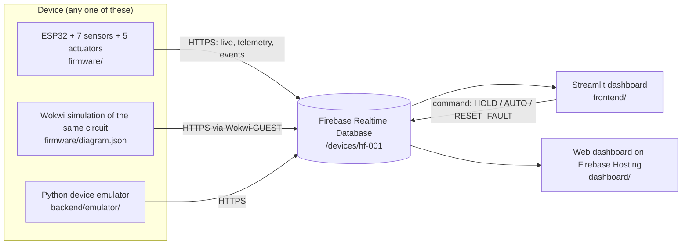

# Hybrid-Flow Smart Irrigation & Energy Manager

ESP32 controller that waters two irrigation zones on solar power first and falls back to the grid only when the soil is critically dry. It protects the pump against dry running, over-current and blocked lines, meters solar versus grid energy, and streams everything to Firebase for a Streamlit dashboard.

BITE401P Embedded Systems and IoT · Project Review 1



## What's in the repo

| Folder | What it is |
|---|---|
| `firmware/hybrid_flow/` | ESP32 Arduino sketch. `control_logic.*` is the switching and protection state machine with no Arduino dependencies; `sensors.*` reads the 7 sensors; `cloud.*` handles Wi-Fi, NTP and Firebase on core 0 with offline buffering. |
| `firmware/diagram.json`, `wokwi.toml`, `libraries.txt`, `platformio.ini` | Wokwi simulation of the full circuit, and PlatformIO builds for hardware and Wokwi. |
| `frontend/` | **Streamlit dashboard** (Python). Runs its own simulator, or reads a real/Wokwi/emulated device from Firebase. |
| `backend/firebase/` | Realtime Database security and validation rules. `firebase.json` at the root deploys them. |
| `backend/emulator/` | Python package `hybridflow` (controller port, farm model, Firebase client) and `device_emulator.py`, which behaves exactly like the ESP32 on the network. |
| `dashboard/` | Static HTML/CSS/JS dashboard for Firebase Hosting, as listed in section VII-B of the review. Optional. |
| `tests/` | `scenarios.json`: 15 behaviour scenarios that the C++, Python and JavaScript controllers all pass. |
| `docs/data-model.md` | Firebase paths and JSON shapes. |

## Quick start: dashboard demo (2 minutes, no hardware, no cloud)

```bash
cd frontend
pip install -r requirements.txt
streamlit run app.py
```

The dashboard opens on the built-in simulator, which runs the firmware's control logic against a model of the farm. Press **Run guided demo** in the sidebar. Over about six minutes it shows:

1. Cloud cover while Zone 2 is below 30 %: debounced solar loss, break-before-make changeover to grid, and back to solar when the sun returns
2. Tank runs dry: dry-run trip (current under 0.5 A for 3 s)
3. Blocked line: no-flow trip (under 1 L/min for 5 s after start-up)
4. Wi-Fi outage: control continues, data is buffered and uploaded on reconnect
5. Heatwave above 45 °C: irrigation paused with an alarm
6. Tank above 95 %: valves close until it drops below 90 %
7. Jammed impeller: over-current trip after the 1 s inrush window

Each scenario can also be triggered on its own from the sidebar.

## Full pipeline with Firebase

1. **Create the database.** In the [Firebase console](https://console.firebase.google.com) create a project, then Build → Realtime Database → Create database. Open the Rules tab, paste `backend/firebase/database.rules.json` and publish. Copy the database URL (it ends in `firebaseio.com` or `firebasedatabase.app`).
2. **Start a device**, one of:
   - **Emulator** (fastest): `cd backend/emulator` then `python device_emulator.py --db <URL> --reset`. Standard library only, no install. Add `--tour` to run the guided scenarios from the device side.
   - **Wokwi**: see below.
   - **ESP32 hardware**: see below.
3. **Open the dashboard.** In Streamlit choose *Firebase* in the sidebar, paste the URL and press Connect. Hold, Auto and Reset fault write to `/command`; the device picks them up within 3 s.

## Wokwi simulation

`firmware/diagram.json` wires the ESP32 DevKit to the same pins as the review's pin table:

| Wokwi part | Stands in for | GPIO |
|---|---|---|
| Potentiometer `pot_solar` | Solar voltage divider (full scale 26 V; start value 20 V) | 34 |
| Potentiometers `pot_soil1`, `pot_soil2` | Capacitive soil probes, Zone 1 and Zone 2 (turn right = drier) | 35, 39 (VN) |
| Photoresistor module | LDR | 32 |
| DHT22 | Temperature and humidity (click it to change values) | 4 |
| HC-SR04 | Tank level (click it to change the distance; 120 cm = empty, 10 cm = full) | 13 trig, 14 echo |
| Push button | Overflow float switch (hold = tank full) | 26 |
| Potentiometers `pot_current`, `pot_flow` | ACS712 current and YF-S201 flow, read only while the pump is on (Wokwi has no flow sensor part) | 33, 36 (VP) |
| Relay module `relay_src` + Solar/Grid LEDs | CH1 source changeover | 25 |
| Relay modules `relay_z1`, `relay_z2` + valve LEDs | Zone solenoid valves | 16, 17 |
| Green LED | Pump-enable SSR | 18 |
| Buzzer, red LED | Alerts | 19, 23 |

At start Zone 2 reads 25 % with the panel at 20 V, so the Zone 2 valve LED lights, then the pump LED a second later, on solar. Things to try: turn `pot_soil2` left past 60 % and the zone finishes (pump first, valve half a second later). Turn `pot_solar` left below 18 V while Zone 2 is below 30 %: after 5 s the Solar LED goes out and the Grid LED comes on, with the pump LED blinking off across the changeover. Turn `pot_current` to zero while the pump runs for a dry-run trip, or `pot_flow` to zero for a no-flow trip. Type `r` in the serial monitor to reset a fault, `h` to hold, `a` for auto.

**On wokwi.com:** start a new ESP32 project, replace `sketch.ino` with `hybrid_flow.ino`, add the other files from `firmware/hybrid_flow/` as new files, and paste `diagram.json` and `libraries.txt` over the project's own. In `config.h` change `#define WOKWI_SIM 0` to `1`. Create `secrets.h` from `secrets.example.h` with SSID `Wokwi-GUEST`, an empty password and your database URL. The simulated ESP32 then publishes to Firebase like real hardware.

**In VS Code:** install the PlatformIO and Wokwi extensions, create `firmware/hybrid_flow/secrets.h` as above, run `pio run -e wokwi` in `firmware/`, then *Wokwi: Start Simulator*. The `wokwi` environment sets `WOKWI_SIM=1` for you.

## ESP32 hardware

1. Copy `firmware/hybrid_flow/secrets.example.h` to `secrets.h` and fill in Wi-Fi and the database URL. It is git-ignored.
2. Arduino IDE: install the ESP32 board package and the *DHT sensor library* and *Adafruit Unified Sensor* libraries, open `firmware/hybrid_flow/hybrid_flow.ino`, board *ESP32 Dev Module*. Or with PlatformIO: `cd firmware && pio run -t upload`.
3. Calibrate in `config.h`: soil probe dry/wet millivolts, tank empty/full distances, divider ratios.
4. Open the serial monitor at 115200 baud for a status line every second and every event.

The firmware sets every output to its safe state before anything else at boot (pump off, valves closed, relay on the solar contact), runs the control loop at 10 Hz on core 1, and keeps all network work on core 0 so a slow HTTPS call never delays a protection trip.

## Control logic

From section VII-C/D of the review, implemented in `firmware/hybrid_flow/control_logic.cpp`:

| Rule | Value |
|---|---|
| Solar has priority when the panel is above | 18 V, held for 5 s (debounce) |
| Grid is allowed only for a zone below | 30 % soil moisture |
| A zone is watered on free solar power below | 50 % *(firmware addition: the review doesn't say when to water on solar)* |
| A running zone stops at | 60 % |
| Tank overflow | ≥ 95 % closes valves; resumes below 90 % |
| Temperature alert | outside 0–45 °C, 2 °C hysteresis |
| Dry run | < 0.5 A for 3 s |
| Over-current | > 8 A, ignored for the first 1 s of motor inrush |
| No flow | < 1 L/min for 5 s, checked from 5 s after start |
| Changeover | pump off → 200 ms → relay moves → 200 ms → pump on |
| Valve sequencing | valve opens 1 s before the pump; pump stops 0.5 s before the valve closes |

One zone runs at a time, driest first. Pump faults latch until an operator reset.

## Tests

The behaviour spec in `tests/scenarios.json` runs against all three implementations of the controller. Each run also checks two invariants on every 100 ms tick: the pump is never on with all valves closed, and the source relay never moves while the pump is energised.

```bash
make -C tests/firmware            # C++ firmware logic (g++)
make -C tests/firmware syntax     # whole sketch compiles against host stand-ins for the Arduino APIs
cd backend/emulator && python -m unittest discover -s tests
cd frontend && python -m unittest discover -s tests
node dashboard/tests/run_scenarios.js
```

GitHub Actions runs all of them on every push.

## Notes for the review

Points found while implementing the design that the examiner may ask about:

- **Solar divider.** The common 30 kΩ / 7.5 kΩ voltage-sensor module divides by 5, which on the ESP32's 3.3 V ADC tops out at 16.5 V, below the 18 V threshold, and a ~22 V open-circuit panel would overdrive the pin. The firmware assumes 47 kΩ / 6.8 kΩ (26 V full scale).
- **Pump supply.** The relay (250 V AC) and SSR-25DA (AC output) imply an AC pump, so the solar side needs an inverter between the panel and CH1. Energy is metered as 230 V × I(rms) × PF 0.8 on both sources.
- **Second soil probe.** The pin table lists one soil pin; Zone 2's probe uses GPIO39 (VN), another ADC1 input.
- **ACS712 output.** It swings around 2.5 V on a 5 V supply, so it needs a divider into the 3.3 V ADC; the firmware computes true RMS over two mains cycles.
- **Tank rule.** The review closes the valves at 95 % tank level. That is implemented as written; it is worth stating what the tank feeds so the rule's purpose is clear.

## Data model

See [docs/data-model.md](docs/data-model.md).
